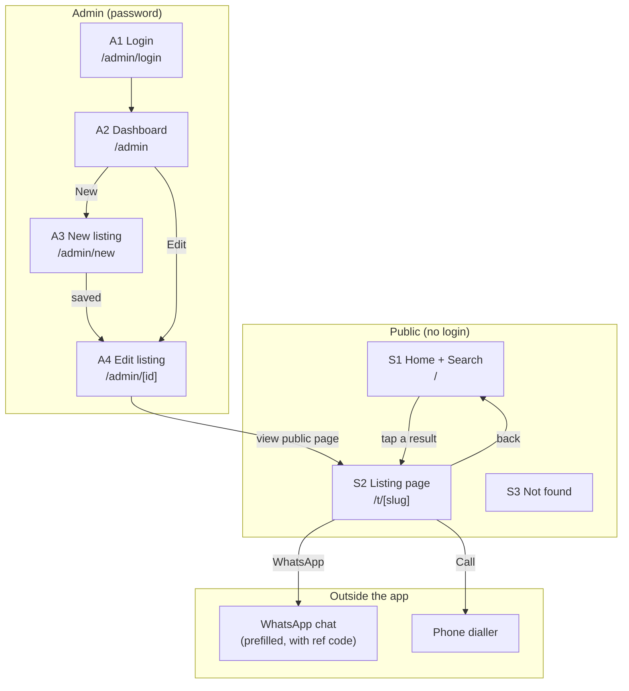
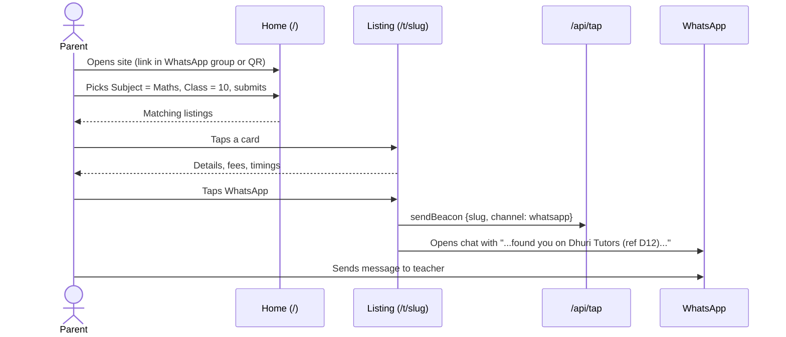
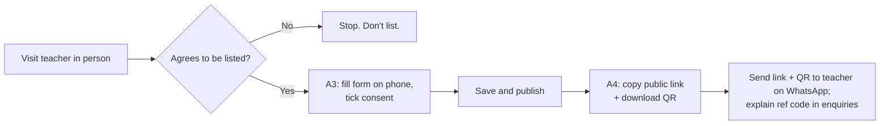

# App Flow: Dhuri Tutors

> Screens and user flows. Layout and visual style for each screen come from `design.md`.
> V0 screens are built now; V1 screens are listed so the structure leaves room for them.

## 1. Screen map

## 2. Screens

### Public

| ID | Screen | Route | Contents | Actions |
|---|---|---|---|---|
| S1 | Home + Search | `/` | Title "Find a tuition teacher in Dhuri", short line of help text; filter form (Subject, Class, Area, Mode dropdowns, optional name box); Search and Clear buttons; result count; result cards; empty state; footer line inviting teachers to get listed | Submit filters (GET → URL like `/?subject=Maths&class=10`); tap a card |
| S2 | Listing page | `/t/[slug]` | Back link; type (teacher/academy); name; contact person; subject chips; **WhatsApp** and **Call** buttons near the top; details table (classes, boards, fees + note, timings, mode, area/address); about text; "Details confirmed X ago"; "Ref D12"; "Share on WhatsApp" button | WhatsApp (counts tap, opens chat); Call (counts tap, opens dialler); Share |
| S3 | Not found | any unknown or unpublished slug | Message + "See all teachers" button | Go home |

**Result card (on S1):** name, teacher/academy · area, fee range (right), subject chips, classes, modes.

### Admin

| ID | Screen | Route | Contents | Actions |
|---|---|---|---|---|
| A1 | Login | `/admin/login` | Password field, Log in button, error message | Log in |
| A2 | Dashboard | `/admin` | Top: counts (live listings, unpublished, needing re-confirm). Table/cards per listing: name, ref code, Live/Hidden badge, last confirmed (red if > 60 days), WhatsApp taps (30d / total), Call taps (30d / total). Buttons: New listing, Log out | Edit; Mark verified today; Publish/Unpublish; Download QR; Open public page |
| A3 | New listing | `/admin/new` | Listing form (all fields, see below) | Save as hidden; Save and publish |
| A4 | Edit listing | `/admin/[id]` | Same form, prefilled; read-only ref code; public link with Copy button; QR preview + Download | Save; Publish/Unpublish; Mark verified |

**Listing form fields (A3/A4), in this order:** Type (teacher/academy) · Name · Contact person · Phone · WhatsApp (if different) · Subjects (checkboxes) · Classes (checkboxes) · Boards (checkboxes) · Mode (checkboxes) · Area (dropdown) · Address/landmark · Fee min · Fee max · Fee note · Timings · About · Slug (prefilled from name, editable) · "Teacher agreed to be listed" checkbox (shows date once given).

### V1 screens (not built in V0)

| ID | Screen | Route |
|---|---|---|
| T1 | Teacher submit form | `/join` |
| T2 | Teacher edit via private link | `/edit/[token]` |
| A5 | Approval queue (new submissions + name/phone changes) | `/admin/approvals` |

## 3. User flows

### Flow 1: Parent finds and contacts a teacher (main flow)

Edge cases:
- No results → empty state suggests fewer filters.
- JavaScript off → WhatsApp/Call still open; tap not counted.
- Tap logging fails → contact still opens; nothing shown to the user.

### Flow 2: Parent arrives from a shared listing link

1. Parent taps a `/t/<slug>` link in a WhatsApp group; WhatsApp shows a preview with name and subjects.
2. Listing page opens directly → WhatsApp or Call.
3. "← All teachers" link leads to search.
4. If the listing has been unpublished → S3 Not found with a link to search.

### Flow 3: Admin onboards a teacher (V0 supply flow)

Rules: no listing is published without the consent box ticked. The first save generates the slug (`sharma-maths-classes`) and ref code (`D7`).

### Flow 4: Admin keeps listings current

1. A2 shows listings not confirmed in 60+ days in red.
2. Admin messages the teacher: "Are your fees and timings still the same?"
3. If changed → A4 edit → Save. Either way → **Mark verified today**.
4. Teacher stopped teaching → Unpublish (the link then shows Not found).

### Flow 5: Monthly check of tap counts against real enquiries

1. Admin opens A2, notes each listing's 30-day WhatsApp + Call taps.
2. Asks each teacher how many enquiries mentioned the app or a ref code.
3. Records both numbers (spreadsheet for V0; stats messages to teachers come in V1).

### Flow 6 (V1): Teacher self-submits and edits

1. Teacher opens `/join` → fills short form → submits (unpublished, in approval queue).
2. Admin reviews in A5 → approves → teacher receives public link and private edit link on WhatsApp.
3. Teacher opens `/edit/<token>` to update fees, timings, about. Name or phone changes go to A5 for approval before they show publicly.
4. Lost or leaked link → admin issues a new token; the old one stops working.

## 4. Navigation and states

- Public pages: header with app name (links home) and city; no menu.
- Admin pages: header with Dashboard, New listing, Log out.
- Every admin route redirects to `/admin/login` if the cookie is missing or wrong.
- Forms keep entered values when validation fails and show the error next to the field.
- Loading: server-rendered pages, so no spinners on public screens; submit buttons show "Saving…" and disable while a server action runs.
