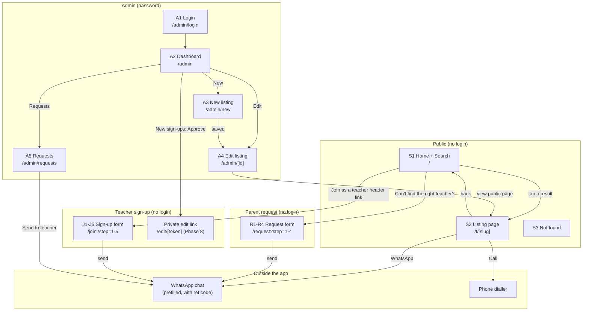
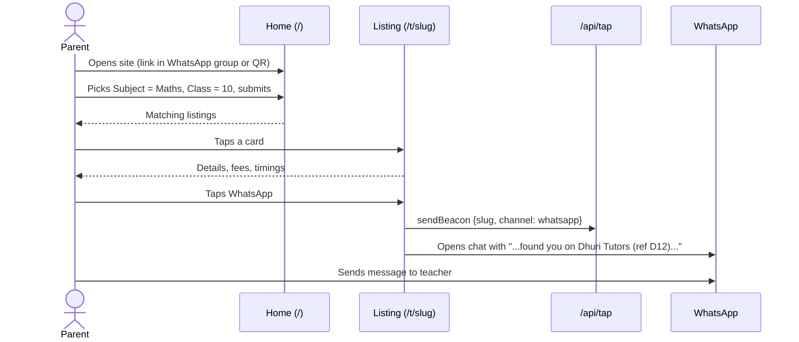
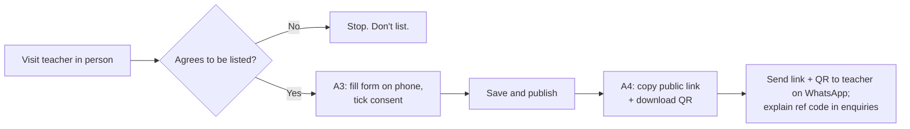
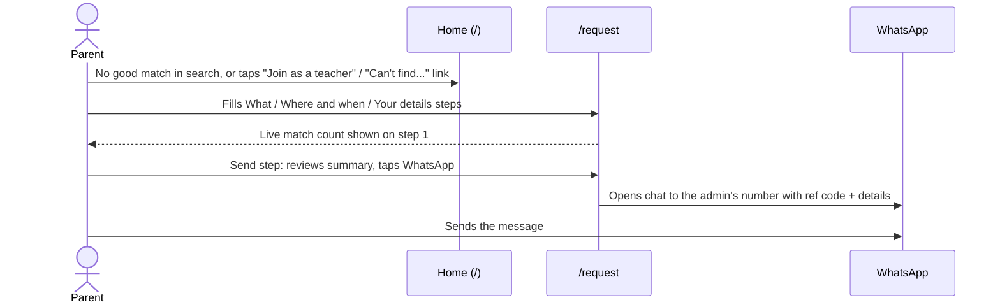

# App Flow: Dhuri Tutors

> Screens and user flows. Layout and visual style for each screen come from `design.md`.
> V0 screens are built now; V1 screens are listed so the structure leaves room for them.

## 1. Screen map

## 2. Screens

### Public

| ID | Screen | Route | Contents | Actions |
|---|---|---|---|---|
| S1 | Home + Search | `/` | Title "Find a tuition teacher in Dhuri", short line of help text; filter form (Subject, Class, Area, Mode dropdowns, optional name box); Search and Clear buttons; result count; result cards; empty state; footer line inviting teachers to get listed | Submit filters (GET → URL like `/?subject=Maths&class=10`); tap a card |
| S2 | Listing page | `/t/[slug]` | Back link; type (teacher/academy); name; contact person; subject chips; **WhatsApp** and **Call** buttons near the top; details table (classes, boards, fees + note, timings, mode, area/address, "Comes to: &lt;villages&gt;" if `serves_areas` is set); about text; "Details confirmed X ago"; "Ref D12"; "Share on WhatsApp" button | WhatsApp (counts tap, opens chat); Call (counts tap, opens dialler); Share |
| S3 | Not found | any unknown or unpublished slug | Message + "See all teachers" button | Go home |

**Result card (on S1):** name, teacher/academy · area, fee range (right), subject chips, classes, modes.

### Parent request form (public, no login) — Phase 7

Linked from the home page and the no-results message ("Can't find the right teacher? Tell us what you need"). Shared multi-step rules (step bar, `?step=N`, localStorage draft, "What happens next" box, WhatsApp send) are in `design.md` §11.

| ID | Screen | Route | Contents | Actions |
|---|---|---|---|---|
| R1 | What | `/request?step=1` | Step bar (1 of 4); class (grouped dropdown); subjects (search-as-you-type checkboxes + "All subjects for this class"); board (optional); mode; live "N teachers match. See them now." line linking to search with those filters | Continue |
| R2 | Where and when | `/request?step=2` | Step bar (2 of 4); village/area dropdown (optgroups, "Other village" free text); preferred timings (morning/afternoon/evening/weekends); monthly budget min/max (optional) | Back; Continue |
| R3 | Your details | `/request?step=3` | Step bar (3 of 4); "Are you 18 or older?"; if yes: name, mobile; if no: student's first name + parent's name and mobile (required), with "We'll talk to your parent."; notes (≤300 chars, optional); consent checkbox | Back; Continue |
| R4 | Send | `/request?step=4` | Step bar (4 of 4); summary with an Edit link per section; WhatsApp button (ref code + key details); "We'll reply on WhatsApp within 24 hours." | Edit a section; Send on WhatsApp |

### Teacher sign-up form (public, no login) — Phase 8

| ID | Screen | Route | Contents | Actions |
|---|---|---|---|---|
| J1 | About you | `/join?step=1` | Step bar (1 of 5); teacher/academy option boxes; full name (≤100 chars); academy name (if academy); mobile; WhatsApp if different; where you live or teach from (area dropdown); address/landmark (optional); note that the exact address is never shown publicly unless added | Continue |
| J2 | Teaching | `/join?step=2` | Step bar (2 of 5); tabs School / Entrance and competitive exams / Skills and activities; "Add to teaching list" box per tab; "Your teaching list" above with Remove links (unfinished tab selections kept when switching tabs); boards (PSEB/CBSE/ICSE) chosen once for the listing; mode as three option boxes; "Villages I can travel to" (multi-select area list) shown when Home tuition is ticked | Back; Continue |
| J3 | Profile | `/join?step=3` | Step bar (3 of 5); years teaching; highest qualification (dropdown); qualification details (optional); teaching languages (Punjabi/Hindi/English); fee min/max per month (both or neither) + fee note; timings; short headline (≤80 chars, optional); about (≤600 chars) | Back; Continue |
| J4 | Review | `/join?step=4` | Step bar (4 of 5); the real public listing page as a preview ("This is what parents will see"); Edit link per step; consent checkbox ("I agree to be listed publicly...") | Back; Continue |
| J5 | Send | `/join?step=5` | Step bar (5 of 5); WhatsApp button (ref code, e.g. `J7`); "We'll check your details and publish your page within 2 days." | Send on WhatsApp |

**Private edit link (Phase 8):** once the admin approves a sign-up from A2, the teacher gets a private link (`/edit/[token]`) on WhatsApp alongside their public link and QR, so they can update their own listing later with no password.

### Admin

| ID | Screen | Route | Contents | Actions |
|---|---|---|---|---|
| A1 | Login | `/admin/login` | Password field, Log in button, error message | Log in |
| A2 | Dashboard | `/admin` | Top: counts (live listings, unpublished, needing re-confirm, new requests). "New sign-ups" section (from `/join`). Table/cards per listing: name, ref code, Live/Hidden badge, last confirmed (red if > 60 days), WhatsApp taps (30d / total), Call taps (30d / total). Buttons: New listing, Requests, Log out | Edit; Mark verified today; Publish/Unpublish; Download QR; Open public page; Approve/Reject sign-up |
| A3 | New listing | `/admin/new` | Listing form (all fields, see below) | Save as hidden; Save and publish |
| A4 | Edit listing | `/admin/[id]` | Same form, prefilled; read-only ref code; public link with Copy button; QR preview + Download | Save; Publish/Unpublish; Mark verified |
| A5 | Requests | `/admin/requests` | List of parent requests, newest first, status (new/contacted/matched/closed); each shows matching published teachers (area or `serves_areas`); "No teacher found" report grouped by subject, class and village | Send to teacher (WhatsApp; includes the parent's number only if "Parent agreed to share number" is ticked); change status |

**Listing form fields (A3/A4), in this order:** Type (teacher/academy) · Name · Contact person · Phone · WhatsApp (if different) · teaching list (Phase 8's shared component: School/Exam/Skill tabs) · Boards (checkboxes) · Mode (checkboxes) · Area (dropdown) · Villages I can travel to (`serves_areas`, if Home tuition) · Address/landmark · Fee min · Fee max · Fee note · Timings · About · Slug (prefilled from name, editable) · "Teacher agreed to be listed" checkbox (shows date once given).

## 3. User flows

### Flow 1: Parent finds and contacts a teacher (main flow)

Edge cases:
- No results → empty state suggests fewer filters.
- JavaScript off → WhatsApp/Call still open; tap not counted.
- Tap logging fails → contact still opens; nothing shown to the user.

### Flow 2: Parent arrives from a shared listing link

1. Parent taps a `/t/<slug>` link in a WhatsApp group; WhatsApp shows a preview with name and subjects.
2. Listing page opens directly → WhatsApp or Call.
3. "← All teachers" link leads to search.
4. If the listing has been unpublished → S3 Not found with a link to search.

### Flow 3: Admin onboards a teacher (V0 supply flow)

Rules: no listing is published without the consent box ticked. The first save generates the slug (`sharma-maths-classes`) and ref code (`D7`).

### Flow 4: Admin keeps listings current

1. A2 shows listings not confirmed in 60+ days in red.
2. Admin messages the teacher: "Are your fees and timings still the same?"
3. If changed → A4 edit → Save. Either way → **Mark verified today**.
4. Teacher stopped teaching → Unpublish (the link then shows Not found).

### Flow 5: Monthly check of tap counts against real enquiries

1. Admin opens A2, notes each listing's 30-day WhatsApp + Call taps.
2. Asks each teacher how many enquiries mentioned the app or a ref code.
3. Records both numbers (spreadsheet for V0; stats messages to teachers come in V1).

### Flow 6: Parent submits a request (Phase 7)

Edge cases: refreshing mid-form restores the draft from `localStorage`; closing the tab before Send loses nothing on the next visit from the same phone; nothing is saved server-side until Send.

### Flow 7: Admin matches a request to teachers (Phase 7)

1. Admin opens A5 (`/admin/requests`), sees new requests newest first.
2. Opens a request, sees its matching published teachers (by area or `serves_areas`).
3. Taps "Send to teacher" for a match → WhatsApp opens to that teacher with the request's details (the parent's number is included only if they agreed to share it).
4. Admin updates the request's status (contacted / matched / closed).
5. Requests with zero matches appear in the "No teacher found" report, grouped by subject, class and village — used to recruit teachers for the gaps.

### Flow 8 (was Flow 6): Teacher signs up and gets approved (Phase 8)

1. Teacher opens `/join` → fills the 5-step form → sends (saved unpublished, `source='self'`, ref code e.g. `J7`).
2. Admin reviews it in A2's "New sign-ups" section.
3. **Approve** → publishes the listing and issues a private edit link; admin sends the teacher their public link, QR code and private edit link on WhatsApp. **Reject** → stays unpublished.
4. Teacher later opens `/edit/<token>` to update their own listing directly — no separate approval step for routine edits.
5. Lost or leaked link → admin issues a new token; the old one stops working.

## 4. Navigation and states

- Public pages: header with app name (links home), a "Join as a teacher" link (secondary button, small) on the right, and city; no menu otherwise.
- Admin pages: header with Dashboard, New listing, Requests, Log out.
- Every admin route redirects to `/admin/login` if the cookie is missing or wrong.
- Forms keep entered values when validation fails and show the error next to the field.
- Multi-step forms (`/request`, `/join`): one step per screen, reachable directly by `?step=N`; the draft is kept in `localStorage` (wrapped in try/catch) so a refresh loses nothing; "Your progress is saved on this phone" is shown under the form.
- Loading: server-rendered pages, so no spinners on public screens; submit buttons show "Saving…" and disable while a server action runs.
