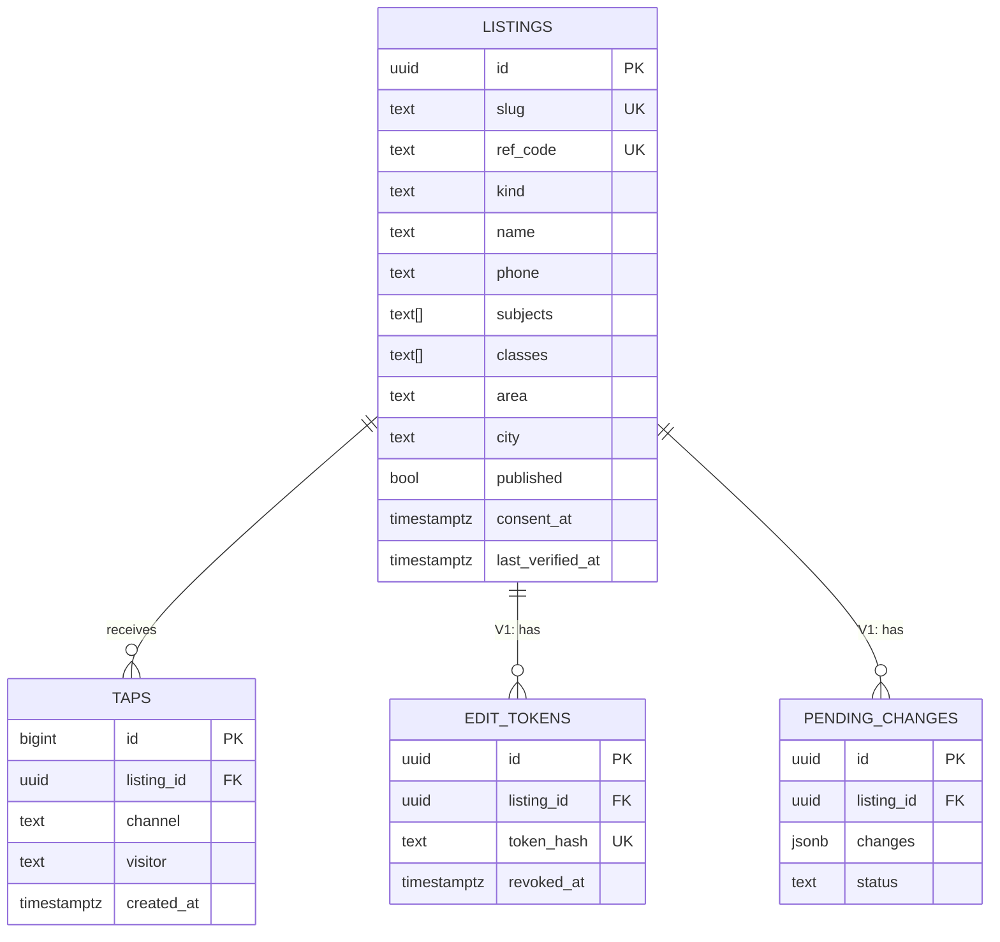

# Database Schema and Data Flow: Dhuri Tutors

> Database: Supabase PostgreSQL. All access is server-side with the service-role key.
> Migrations: `supabase/migrations/NNNN_description.sql`. Never edit an applied migration.

## 1. Entity relationships



- One listing has many taps. Deleting a listing deletes its taps (`on delete cascade`). In practice listings are unpublished, not deleted.
- V1 tables (`edit_tokens`, `pending_changes`) are designed here but created only in Phase 7.

## 2. Tables (V0)

### `listings`

| Column | Type | Null | Default | Notes |
|---|---|---|---|---|
| id | uuid | no | `gen_random_uuid()` | PK |
| slug | text | no | | Unique. Public URL part, e.g. `sharma-maths-classes` |
| ref_code | text | no | | Unique. Short code in WhatsApp message, e.g. `D12`. Never reused |
| kind | text | no | | `check (kind in ('teacher','academy'))` |
| name | text | no | | |
| contact_person | text | yes | | |
| phone | text | no | | 10 digits, no country code |
| whatsapp | text | yes | | 10 digits; null = same as phone |
| subjects | text[] | no | `'{}'` | Values from `lib/config.ts` |
| classes | text[] | no | `'{}'` | e.g. `{"9","10","jee"}`. Values from `lib/config.ts` CLASSES (stable lowercase `value`s, never renamed once data exists) |
| boards | text[] | no | `'{}'` | `PSEB`, `CBSE`, `ICSE` |
| modes | text[] | no | `'{}'` | `academy`, `home`, `online` |
| area | text | no | | Locality from config list |
| address | text | yes | | Landmark-level, optional |
| city | text | no | `'Dhuri'` | Enables more towns later |
| fee_min | integer | yes | | Rupees per month |
| fee_max | integer | yes | | `check (fee_min is null or fee_max is null or fee_min <= fee_max)` |
| fee_note | text | yes | | e.g. "per subject" |
| timings | text | yes | | Free text, e.g. "Mon–Sat 4–6 pm" |
| about | text | yes | | ≤ 600 chars |
| published | boolean | no | `false` | Only published rows appear publicly |
| consent_at | timestamptz | yes | | Set when teacher agrees; required to publish (`check (not published or consent_at is not null)`) |
| last_verified_at | timestamptz | yes | | Shown as "details confirmed X ago" |
| created_at | timestamptz | no | `now()` | |
| updated_at | timestamptz | no | `now()` | Set by trigger on update |

Indexes:
- `unique (slug)`, `unique (ref_code)`
- `(city, published)` for the public search
- GIN on `subjects`, `classes`, `modes` for array-contains filters

### `taps`

| Column | Type | Null | Default | Notes |
|---|---|---|---|---|
| id | bigserial | no | | PK |
| listing_id | uuid | no | | FK → `listings.id`, `on delete cascade` |
| channel | text | no | | `check (channel in ('whatsapp','call'))` |
| visitor | text | yes | | First 24 hex chars of `sha256(TAP_SALT|ip|user-agent)`. Never the raw IP |
| created_at | timestamptz | no | `now()` | |

Index: `(listing_id, created_at desc)`.

### View `listing_tap_counts` (security_invoker)

De-duplicates taps: same `listing_id` + `channel` + `visitor` + calendar day (Asia/Kolkata) counts once.

| Column | Meaning |
|---|---|
| listing_id | |
| whatsapp_total, call_total | Unique taps, all time |
| whatsapp_30d, call_30d | Unique taps, last 30 days |

```sql
create or replace view listing_tap_counts with (security_invoker = true) as
with unique_taps as (
  select distinct on (listing_id, channel, coalesce(visitor, id::text),
                      (created_at at time zone 'Asia/Kolkata')::date)
    listing_id, channel, created_at
  from taps
)
select
  l.id as listing_id,
  count(t.listing_id) filter (where t.channel = 'whatsapp') as whatsapp_total,
  count(t.listing_id) filter (where t.channel = 'call')     as call_total,
  count(t.listing_id) filter (where t.channel = 'whatsapp' and t.created_at > now() - interval '30 days') as whatsapp_30d,
  count(t.listing_id) filter (where t.channel = 'call'     and t.created_at > now() - interval '30 days') as call_30d
from listings l
left join unique_taps t on t.listing_id = l.id
group by l.id;
```

### Trigger

`set_updated_at` (before update on `listings`): `new.updated_at = now()`.

### Security

```sql
alter table listings enable row level security;
alter table taps     enable row level security;
-- No policies on purpose: only the service-role key (server-side) can read or write.
```

## 3. Tables (V1, created in Phase 7)

### `edit_tokens`

| Column | Type | Notes |
|---|---|---|
| id | uuid PK | |
| listing_id | uuid FK → listings, cascade | |
| token_hash | text unique | SHA-256 of the token; the raw token is only ever in the WhatsApp message to the teacher |
| created_at | timestamptz | |
| revoked_at | timestamptz null | Set when a new link is issued |

### `pending_changes`

| Column | Type | Notes |
|---|---|---|
| id | uuid PK | |
| listing_id | uuid FK → listings, null for brand-new submissions | |
| changes | jsonb | Proposed field values |
| kind | text | `new_listing` or `identity_change` (name/phone) |
| status | text | `pending`, `approved`, `rejected` |
| created_at, decided_at | timestamptz | |

## 4. Data flows

### 4.1 Search (read)

```
Parent submits filters (GET /?subject=Maths&class=10&area=...&mode=...&q=...)
  → app/page.tsx validates each param against lib/config.ts lists (unknown values ignored)
  → data.searchListings(filters)
      select * from listings
      where published and city = :CITY
        and subjects @> {:subject} and classes @> {:class} and modes @> {:mode} and area = :area
        and (name ilike %q% or contact_person ilike %q% or about ilike %q%)   -- q cleaned to letters/digits/spaces
      order by last_verified_at desc nulls last, name
  → server renders result cards
```

### 4.2 Listing page (read)

```
GET /t/:slug → data.getListingBySlug(slug)   -- published only
  → found: render page + OG tags;  not found: 404 page
```

### 4.3 Contact tap (write)

```
Parent taps WhatsApp/Call
  ├─ browser: navigator.sendBeacon('/api/tap', {slug, channel})
  │     → route: reject bots → getListingBySlug → visitor = hash(salt|ip|ua) → insert into taps
  └─ browser: follows the button's href (wa.me / tel:) at the same time
```

### 4.4 Admin onboarding (write)

```
Admin submits A3 form → createListingAction
  → requireAdmin() → validate (lib/validation.ts)
  → slug = unique slugify(name); ref_code = nextRefCode()   -- 'D' + (max existing number + 1)
  → consent_at = now() if consent ticked
  → insert listings → redirect to /admin/[id]
```

### 4.5 Re-verification (write)

```
Admin taps "Mark verified today" → markVerifiedAction(id) → update listings set last_verified_at = now()
```

### 4.6 Admin stats (read)

```
/admin → listAllListings() + select * from listing_tap_counts → merge by listing_id → render
```

## 5. Migrations plan

| File | Contents | Phase |
|---|---|---|
| `0001_init.sql` | `pgcrypto`, `listings`, `taps`, indexes, checks, RLS, `set_updated_at` trigger, `listing_tap_counts` view | 1 |
| `0002_edit_tokens_pending_changes.sql` | V1 tables | 7 |

`supabase/seed.sql` holds clearly fake sample listings (names starting with "Sample", phones `99999000xx`) and is run **only on the dev project**.
